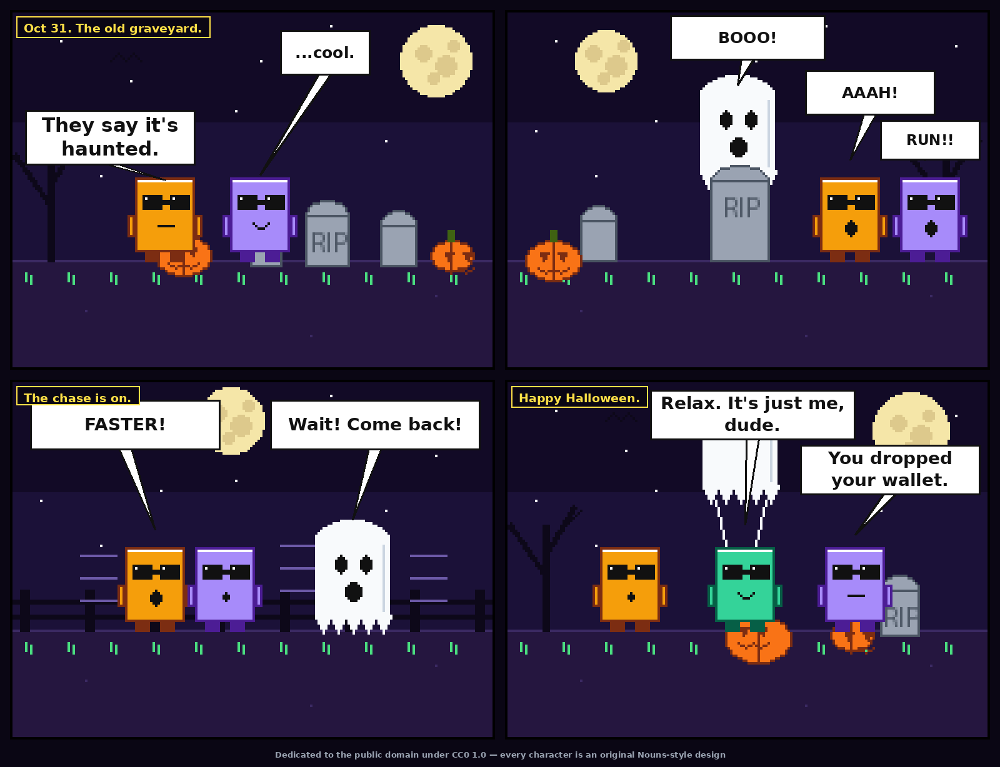

# The Haunted Graveyard — a CC0 Halloween comic

Entry for **poidh bounty #1500 "CC0 Halloween"** (0.05 ETH) — @poidhxyz

A 4-panel Halloween comic starring three original Nouns-style blocky characters (orange, purple, green) with square nogglasses. Two friends brave the old graveyard, a ghost gives chase — and the sheet comes off to reveal their friend returning a dropped wallet. Spooky setup, deadpan humor, mundane twist.

**CC0 1.0 dedication:** By submitting, I dedicate this comic to the public domain under CC0 1.0. Every character in it is an original Nouns-style design rendered procedurally; no movie, TV, game, or non-CC0 collection characters are used. Nouns (nouns.wtf) is a CC0 collection and the stylistic reference.

Rendered procedurally with Python/PIL.
